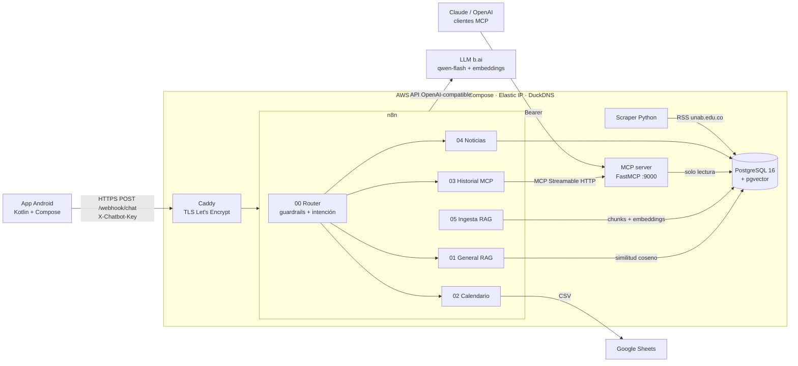

# Asistente Académico UNAB — chatbot híbrido RAG + agentes MCP con n8n

Trabajo final · Tema 2 · Ciencia de Datos · Ingeniería de Sistemas · Universidad Autónoma de Bucaramanga (UNAB)

**Objetivo:** un modelo en n8n que acompaña al estudiante de Ingeniería de Sistemas en la matrícula, su estado académico actual y su proyección, con requisitos y recomendaciones para tener éxito en el programa (investigación, autoaprendizaje y educación de precisión).

> ⚠️ **Todos los datos de estudiantes son sintéticos**: simulan Banner/Cosmos y no corresponden a personas reales. El plan de estudios sí viene del PDF institucional (`Planes de estudio vigente.pdf`); los códigos de curso y los prerrequisitos son ilustrativos porque el PDF no los trae.

| | |
|---|---|
| **Estado** | Código completo y probado en local (BD, MCP, scraper, app). Falta el despliegue en AWS: ver [docs/CONTINUACION.md](docs/CONTINUACION.md) |
| **Demo** | `https://<subdominio>.duckdns.org` (cuando esté desplegado) · estudiante demo `U00000001` |
| **Equipo** | José Téllez (código, datos, workflows, docs) · Santiago Cabezas (infraestructura AWS, despliegue, evidencias) |

---

## 1. ¿Qué responde el chatbot?

| Alcance (diapositiva 9) | Cómo se resuelve | Workflow |
|---|---|---|
| Ruta y cursos: ¿qué cursos debo tomar? ¿qué es la insignia? | RAG sobre documentos + herramienta `cursos_pendientes` | 01 / 03 |
| RAG institucional (documentos del CCD) | Embeddings en PostgreSQL + pgvector | 05 → 01 |
| Calendario académico | Google Sheets (CSV publicado) | 02 |
| Historial personalizado: ¿qué cursos de competencias digitales he tomado? | BD sintética vía servidor MCP | 03 |
| Noticias y novedades | Scraping periódico del RSS de la UNAB | 04 |
| Matrícula, avance, proyección, alertas, recomendaciones (objetivo) | Vistas analíticas + herramientas MCP | 03 |

## 2. Arquitectura



Detalle de cada componente, decisiones y flujo de una pregunta: **[docs/ARQUITECTURA.md](docs/ARQUITECTURA.md)**.

### Componentes avanzados (diapositiva 10)

| Componente | Implementación |
|---|---|
| Ingesta y embeddings | Workflow `05`: lee `data/docs_ccd/*.md` → Recursive splitter (800/120) → embeddings → `public.rag_documentos` (PGVector) |
| Guardrails | Entrada: inyección de prompt, SQL, consultas sobre otro estudiante, datos sensibles, lenguaje ofensivo, longitud. Salida: oculta códigos ajenos y correos, oculta errores técnicos, limita longitud. Todo queda en `academico.chat_log` |
| Memoria persistente | `Postgres Chat Memory` de n8n (`n8n_chat_histories`) por `sessionId`: el contexto sobrevive entre sesiones de la app |
| Ruteo por intención | `Text Classifier` (LLM) → `Execute Workflow` al sub-workflow 01-04 |
| Clientes MCP | Servidor FastMCP con 10 herramientas; lo consumen el agente de n8n y Claude Desktop/Code (ver §6) |

## 3. Estructura del repositorio

```
├── android/                 App Android (Kotlin, Jetpack Compose)        → android/README.md
├── caddy/Caddyfile          Reverse proxy + HTTPS automático
├── data/
│   ├── plan_estudios_ing_sistemas.json   Plan real extraído del PDF (48 cursos, 151 créditos, 9 semestres)
│   ├── calendario_academico.csv          Para importar en Google Sheets
│   └── docs_ccd/*.md                     Corpus del RAG (sintético, marcado como tal)
├── db/init/                 Se ejecuta solo en el primer arranque de Postgres
│   ├── 00_databases.sh      BD de n8n + rol de solo lectura chatbot_ro
│   ├── 01_schema.sql        Esquema `academico` (simula Banner/Cosmos)
│   ├── 02_views.sql         Vistas analíticas para agentes
│   └── 03_seed.sql          Datos sintéticos (GENERADO)
├── docs/                    Arquitectura, despliegue AWS, continuación, modelo de datos, LLM, evidencias
├── mcp-server/              Servidor MCP (FastMCP, Python) en el puerto 9000
├── n8n/
│   ├── build_workflows.py   Workflows como código (fuente)
│   └── workflows/*.json     Workflows importables (GENERADOS)
├── scraper/                 Scraper de noticias (RSS) en Python
├── scripts/                 bootstrap EC2, DuckDNS, import n8n, generador sintético, smoke test
├── docker-compose.yml
├── .env.example
└── BITACORA.md              Bitácora del proyecto
```

## 4. Despliegue rápido (replicable)

Requisitos: una VM Ubuntu 24.04 con ≥ 2 GB de RAM (t3.small + swap funciona; t3.medium recomendado), puertos 22/80/443/9000 abiertos, un subdominio DuckDNS y una API key de un LLM compatible con OpenAI.

```bash
git clone https://github.com/Joserraldo/chatbot-academico-unab.git
```
```bash
cd chatbot-academico-unab && bash scripts/bootstrap-ec2.sh
```
```bash
cp .env.example .env && nano .env
```
```bash
bash scripts/duckdns-update.sh
```
```bash
docker compose up -d --build
```
```bash
bash scripts/n8n-import.sh
```

Después, en `https://<DOMAIN>`: crear el usuario owner de n8n, ejecutar **05 Ingesta RAG** y activar **00 Router** y **04 Noticias**. Verificar con `bash scripts/smoke-test.sh`.

Guía paso a paso con AWS Academy, Security Group, Elastic IP, DuckDNS y la lista de capturas de evidencia: **[docs/DESPLIEGUE-AWS.md](docs/DESPLIEGUE-AWS.md)**.

### ¿Alcanza una máquina de AWS Academy?
Sí. El modelo de lenguaje **no corre en la VM**: se consume por API (b.ai / qwen-flash), así que no hace falta GPU ni una instancia grande. La VM solo corre n8n, Postgres, el MCP server, el scraper y Caddy (~650 MB en reposo). Ver la tabla de tamaños en [docs/DESPLIEGUE-AWS.md](docs/DESPLIEGUE-AWS.md#1-tamaño-de-instancia).

## 5. API del chat (contrato con la app)

```http
POST https://<DOMAIN>/webhook/chat
X-Chatbot-Key: <CHATBOT_KEY>
Content-Type: application/json

{"sessionId": "b6f1…", "codigoEstudiante": "U00000001", "mensaje": "¿Cuántos semestres me faltan?"}
```
```json
{"respuesta": "Llevas 78 de 151 créditos (51,7 %)…", "intencion": "historial", "fuentes": ["Sistema académico (datos sintéticos) vía MCP"]}
```
`intencion` ∈ `general | calendario | historial | noticias | bloqueado`.

## 6. Servidor MCP

`mcp-server/server.py` (FastMCP, transporte Streamable HTTP, `http://<DOMAIN>:9000/mcp`, header `Authorization: Bearer <MCP_TOKEN>`). Usa el rol de BD `chatbot_ro` (solo lectura).

| Herramienta | Qué devuelve |
|---|---|
| `estado_academico` | Matrícula del periodo, créditos, % de avance, promedio ponderado |
| `cursos_pendientes` | Cursos no aprobados (opcional: solo los habilitados por prerrequisitos) |
| `alertas_requisitos` | Cursos bloqueados por prerrequisitos + requisitos de grado pendientes |
| `proyeccion_semestres` | Semestres restantes estimados según el ritmo histórico |
| `recomendaciones` | Recomendaciones personalizadas (reglas de educación de precisión) |
| `competencias_digitales` | Cursos del CCD tomados y progreso hacia la insignia |
| `oferta_competencias_digitales` | Catálogo del CCD por nivel |
| `calendario_academico` | Eventos del calendario (copia en BD) |
| `noticias_recientes` | Noticias del scraper |
| `buscar_documentos` | Búsqueda semántica en `rag_documentos` |

Conectar Claude Code como cliente MCP:
```bash
claude mcp add --transport http unab-academico https://<DOMAIN>/mcp --header "Authorization: Bearer <MCP_TOKEN>"
```

## 7. Desarrollo local (sin AWS)

Con Docker Desktop: `cp .env.example .env`, poner `DOMAIN=localhost` y `docker compose up -d --build`; n8n queda en `http://localhost:5678`. Para regenerar datos o workflows:
```bash
python scripts/generate_synthetic.py
```
```bash
python n8n/build_workflows.py
```
Si cambias `03_seed.sql` con la BD ya creada, hay que recrear el volumen: `docker compose down -v` (borra todo).

## 8. Criterios de evaluación ↔ entregables

| Criterio | Peso | Dónde está |
|---|---|---|
| Arquitectura | 20 % | este README §2, [docs/ARQUITECTURA.md](docs/ARQUITECTURA.md), `docker-compose.yml` |
| RAG | 20 % | workflows `05` y `01`, `data/docs_ccd/`, herramienta MCP `buscar_documentos` |
| Workflows n8n | 20 % | `n8n/workflows/` (router + 5) |
| Base de datos | 10 % | `db/init/`, [docs/MODELO-DATOS.md](docs/MODELO-DATOS.md) |
| App móvil | 20 % | `android/` |
| Documentación | 10 % | `README.md`, `docs/`, `BITACORA.md`, `docs/evidencias/` |

Pendientes de entrega: video demostración y capturas del despliegue (responsable: Santiago, ver [docs/CONTINUACION.md](docs/CONTINUACION.md)).
