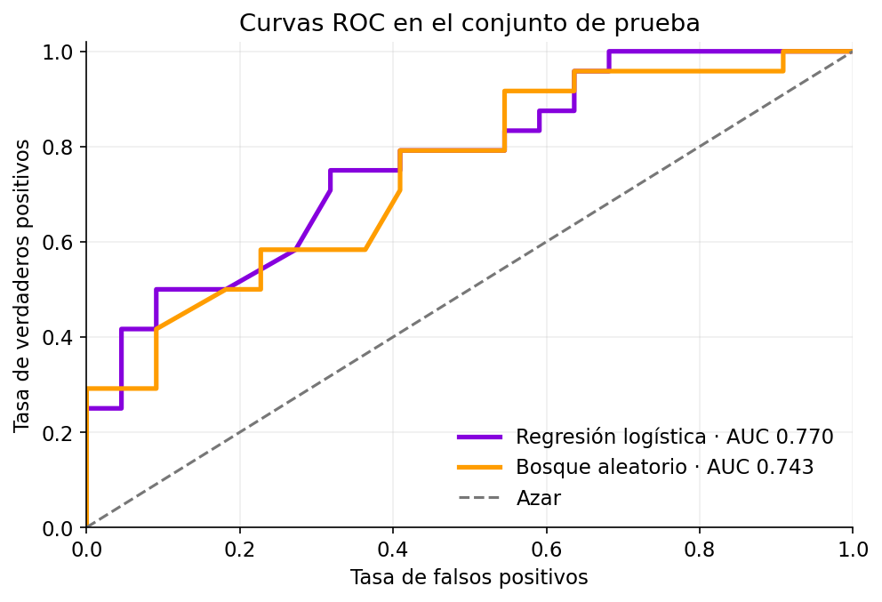
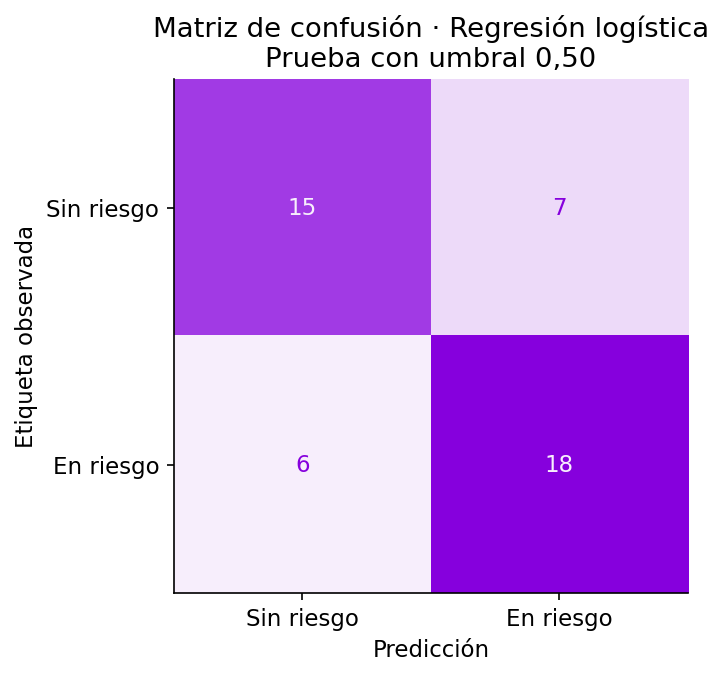
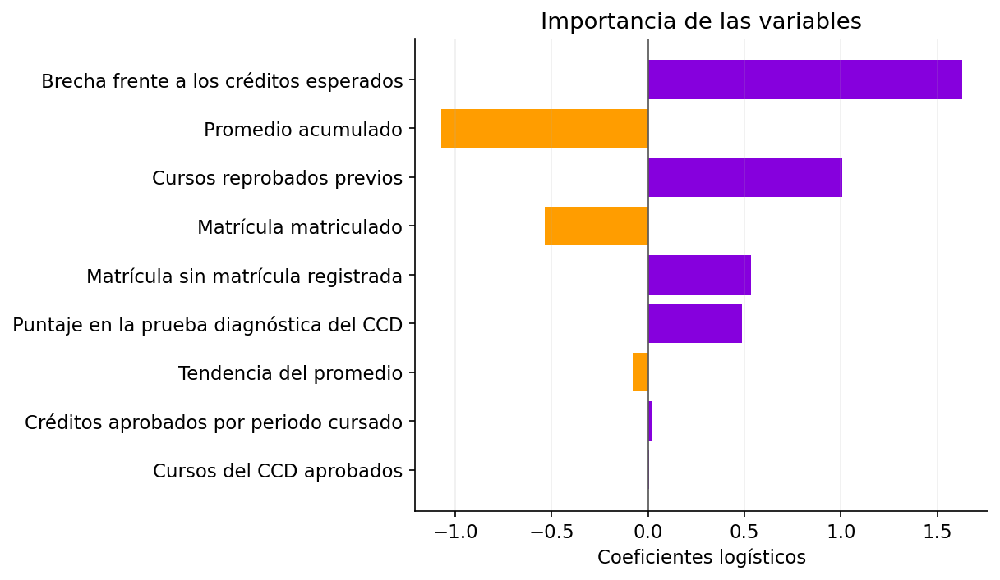
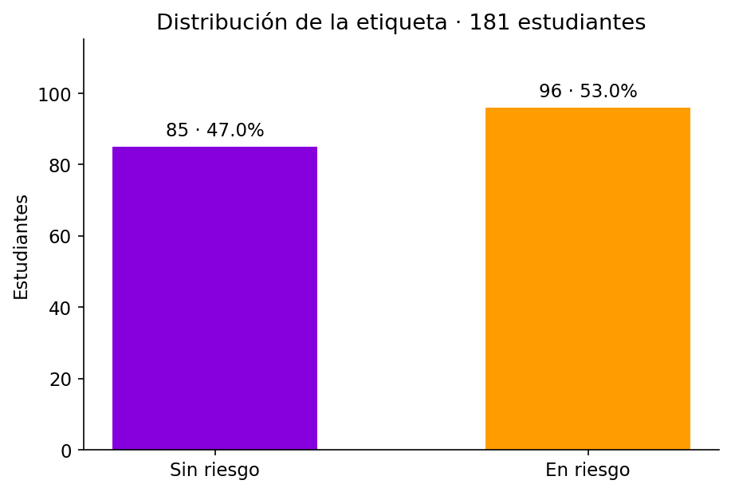

# Riesgo académico · Asistente UNAB 360

La demo estima el riesgo de un resultado académico adverso para orientar apoyos de educación de precisión. Usa datos 100 % sintéticos en PostgreSQL y deja evidencia reproducible en el [cuaderno ejecutado](../analitica/riesgo_academico.ipynb) y las [métricas](../analitica/metricas.json).

## Diseño de la evaluación

La etiqueta es positiva si el estudiante reprobó al menos un curso o si el promedio ponderado por créditos fue inferior a 3,3 en el último periodo cerrado. Entran al conjunto etiquetado los estudiantes con nota final o una reprobación explícita en ese periodo. Se genera una estimación para todos los estudiantes registrados, incluidos quienes carecen de historial.

| Variables | Cálculo |
|---|---|
| Promedio y tendencia | Promedio acumulado ponderado por créditos y pendiente de los tres últimos promedios disponibles, con un mínimo de dos. |
| Reprobaciones y ritmo | Intentos reprobados y promedio de créditos aprobados por periodo con resultados. |
| Brecha de avance | Créditos previstos para los semestres previos en el plan menos créditos aprobados de cursos únicos. El semestre al corte histórico se reconstruye desde la cohorte. La puntuación usa el semestre registrado. |
| Competencias digitales | Diagnóstico más reciente y número de cursos del CCD aprobados hasta la fecha de observación. |
| Matrícula | Estado de matrícula en el periodo de observación. |

Las tareas de TEMA y las notas del corte 1 (Cosmos) existen solo para el periodo actual: sin historial no pueden entrenarse y, al incluirlas, quedaban como columnas vacías sin señal. Se excluyeron del modelo (decisión documentada, no un olvido).

El ajuste toma variables hasta el cierre del periodo previo a la etiqueta. Para puntuar, se usan historial y señales del periodo actual. Las tablas de matrícula, TEMA y notas parciales conservan estados por periodo y carecen de marcas de publicación o un historial de cambios. La reconstrucción depende de la fecha del registro para el CCD y de la adscripción a un periodo para los demás datos.

La partición estratificada reserva un 25 % para prueba. Se comparan regresión logística y bosque aleatorio mediante AUC media en cinco folds estratificados del entrenamiento. Regla de parsimonia: si la logística queda a menos de 0,01 de AUC del mejor modelo (menos que la desviación entre folds) se elige por ser interpretable. Fue lo que ocurrió: el bosque ganó por 0,002 de AUC en CV, un empate técnico, y la logística tuvo mejor AUC, F1 y exactitud en prueba. La imputación numérica, la estandarización y la codificación de matrícula se ajustan dentro de cada fold. La prueba se usa para medir discriminación y desempeño al umbral 0,50. La matriz tiene filas observadas y columnas predichas, en orden sin riesgo, en riesgo.

## Resultados obtenidos

Corte de la demo: 19 de noviembre de 2026. Variables hasta el cierre de 2025-2 (5 de diciembre de 2025), etiqueta en 2026-1, puntuación en 2026-2. Sin fuga: ninguna variable de entrenamiento mira el periodo de la etiqueta. Etiquetados: 181 (96 en riesgo, 53 %; 85 sin riesgo), 135 en entrenamiento y 46 en prueba.

| Modelo | AUC CV (5 folds) | AUC prueba | F1 | Exactitud |
|---|---|---|---|---|
| **Regresión logística (elegido)** | 0,857 ± 0,040 | 0,770 | 0,735 | 0,717 |
| Bosque aleatorio | 0,859 ± 0,034 | 0,743 | 0,680 | 0,652 |

Matriz de confusión de la logística en prueba (filas observadas, columnas predichas; sin riesgo / en riesgo): 15 y 7 / 6 y 18. Las métricas son moderadas, no perfectas, como corresponde a un problema ruidoso: con solo 46 casos de prueba el AUC tiene una incertidumbre amplia, y la distancia entre AUC de CV (0,857) y de prueba (0,770) es varianza de muestra pequeña. Un AUC cercano a 1 habría indicado fuga de información; cercano a 0,5, falta de señal. No es el caso.

Variables más influyentes (coeficiente estandarizado): brecha de avance (+1,63), promedio acumulado (-1,07), reprobados previos (+1,01), matrícula, prueba diagnóstica del CCD (+0,49). La tendencia, los créditos por periodo y los cursos del CCD casi no aportan.

Puntuación de los 206 estudiantes: 84 bajo, 36 medio, 86 alto. Alto es muy frecuente porque la etiqueta sintética tiene 53 % de prevalencia y los umbrales (0,60 y 0,35) se fijaron a priori, sin calibrar. Personas demo, calculadas sin ajustes manuales:

| Código | Persona | Probabilidad | Nivel |
|---|---|---|---|
| U00000201 | Santiago, Sistemas, casi graduado | 0,1102 | bajo |
| U00000202 | Valentina, Medicina | 0,9507 | alto (brecha de 8 créditos, promedio 3,24) |
| U00000203 | Juan Camilo, Derecho | 0,3650 | medio |
| U00000204 | Sofía, Psicología, primer semestre | 0,2885 | bajo |
| U00000205 | Andrés Felipe, Administración | 0,6549 | alto |
| U00000206 | Nicolás, Mecatrónica | 0,4926 | medio |






## Interpretación y límites

En la regresión logística, el aporte numérico es el producto del coeficiente por el valor estandarizado. Su signo indica la dirección en la escala logarítmica de las razones de probabilidad. En el bosque, la importancia global mide el cambio de AUC al permutar la variable y el aporte local mide el cambio de puntaje al sustituir solo esa variable por una referencia de entrenamiento. Los factores se ordenan por magnitud del aporte entre los valores observados. Los niveles de demo se calculan sobre el puntaje almacenado, con cuatro decimales. Alto comienza en 0,60 y medio en 0,35.

La aptitud simulada persiste entre semestres por construcción de la semilla, lo que favorece el aprendizaje de los patrones sintéticos. Faltan una evaluación en cohortes futuras, validación por programa y calibración de probabilidades. La falta de datos y las diferencias en acceso a TEMA pueden producir sesgos. En educación de precisión, una alerta orienta la conversación y la oferta de tutorías con revisión humana. Su uso es orientativo y no punitivo.

## Integración y actualización

El MCP `riesgo_academico(codigo)` lee el puntaje, nivel y factores. La API expone la gráfica `riesgo` mediante `GET /api/graficas/{codigo}?tipo=riesgo`. El dashboard `/app/analitica` usa `GET /api/analitica/resumen` para mostrar el conteo por nivel y las métricas de `servicios.modelo_riesgo`. Estos contratos figuran en [Contratos v2](CONTRATOS-V2.md).

Para regenerar los artefactos (con el entorno `.venv-ml` de `py -3.12`, `analitica/riesgo_academico.py` ejecuta todo en un Postgres temporal y reescribe `db/init/07_v2_riesgo.sql`, las figuras y `analitica/metricas.json`; es determinista con la semilla 42) en Windows sin Docker, sigue el [procedimiento de entrenamiento](../analitica/README.md#reentrenar-en-windows-11-con-git-bash). El script prueba la semilla de riesgo dos veces en el clúster temporal. La transacción reemplaza los puntajes y deja una sola fila de métricas.

En un despliegue nuevo, PostgreSQL aplica `07_v2_riesgo.sql` en orden, después de los roles. Para una base existente en la EC2, aplica primero esquema, semilla y roles v2. Luego carga el artefacto como administrador desde la raíz del proyecto.

```bash
docker compose exec -T postgres sh -c 'psql -v ON_ERROR_STOP=1 -U "$POSTGRES_USER" -d unab' < db/init/07_v2_riesgo.sql
```
