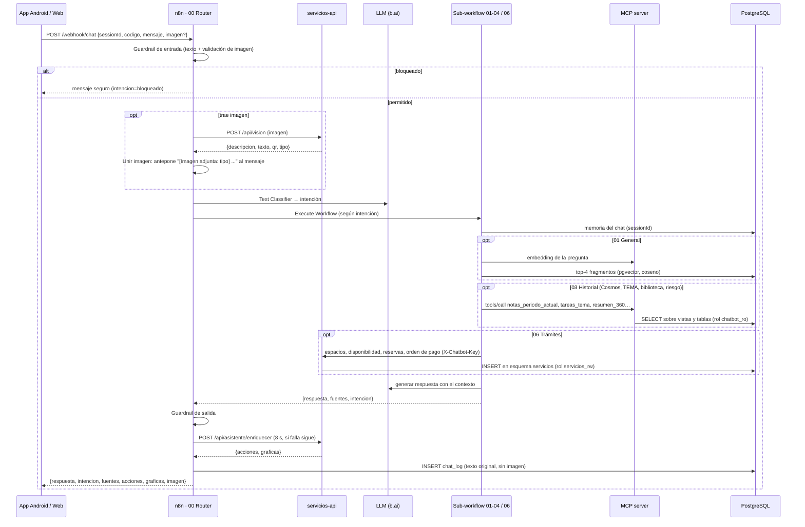

# Arquitectura

## 1. Vista general

Todo corre en **una sola VM** (EC2) con Docker Compose. El único servicio externo de cómputo pesado es el LLM, consumido por API.

| Servicio | Imagen / código | Puerto | Rol |
|---|---|---|---|
| `caddy` | `caddy:2.10-alpine` | 80, 443 (públicos) | TLS automático (Let's Encrypt) para el dominio DuckDNS; enruta `/mcp` al MCP, `/api/*` a `servicios-api`, `/app/*` a la web estática y el resto a n8n |
| `n8n` | `n8nio/n8n:2.47.7` | 5678 (solo localhost) | Orquestación: webhook del chat, guardrails, ruteo, agentes, RAG, ingesta, scraping |
| `postgres` | `pgvector/pgvector:0.8.7-pg16` | interno | BD académica sintética (`academico`), vectores (`public.rag_documentos`), memoria del chat, BD interna de n8n |
| `mcp-server` | `mcp-server/` (Python, FastMCP) | 9000 (MCP por HTTPS en `/mcp`) | Herramientas relacionales y servicio de embeddings multilingües en CPU con credencial aparte |
| `scraper` | `scraper/` (Python) | — | Cada 6 h lee el RSS de unab.edu.co y hace upsert en `academico.noticia` |
| `servicios-api` | `servicios-api/` (FastAPI) | 8000 (público en `/api/*`) | **v2.** Reservas, órdenes de pago Bold, visión, QR, gráficas y enriquecimiento determinista de la respuesta del chat (`acciones`, `graficas`). Contrato en [CONTRATOS-V2.md](CONTRATOS-V2.md) |

> Las diapositivas mencionan **Supabase**. El esquema es 100 % compatible: para usar Supabase en vez del Postgres local se ejecutan `01_schema.sql`, `02_views.sql` y `03_seed.sql` en el SQL Editor de Supabase (con la extensión `vector` activada y el rol `chatbot_ro` creado a mano) y se cambian los hosts en `.env`/credenciales. Se eligió Postgres local por defecto porque no depende de cuentas externas, no tiene límites de pausa del plan gratuito y es más fácil de replicar.

## 2. Flujo de una pregunta

## 3. Workflows de n8n

| ID | Nombre | Disparador | Pipeline |
|---|---|---|---|
| `wfRouterChatUNAB` | 00 Router chat | Webhook POST `/webhook/chat` | Guardrail entrada (texto e imagen) → IF bloqueado → IF imagen → HTTP `/api/vision` → Unir imagen → Text Classifier (6 salidas) → Execute Workflow → Guardrail salida → HTTP `/api/asistente/enriquecer` → Log → Respond |
| `wf01GeneralRAG00` | 01 Consulta general | Execute Workflow | AI Agent + memoria + herramienta PGVector (retrieve-as-tool) |
| `wf02Calendario00` | 02 Calendario | Execute Workflow | HTTP (Google Sheet CSV o PostgreSQL) → Code → LLM Chain |
| `wf03CursosMCP000` | 03 Cursos, notas y estado | Execute Workflow | AI Agent + memoria + MCP Client Tool (incluye las herramientas v2: notas de corte, horario, TEMA, biblioteca, riesgo y `resumen_360`) |
| `wf04Noticias0000` | 04 Noticias | Schedule 6 h **y** Execute Workflow | A: RSS → clasificar → upsert · B: SELECT (últimas 48 h primero; educación, tecnología e ingeniería de sistemas) → LLM Chain con fuente y fecha |
| `wf05IngestaRAG00` | 05 Ingesta RAG | Manual | Leer .md → chunking → embeddings → PGVector → publicar índice en una transacción |
| `wf06Tramites0000` | 06 Trámites, reservas y pagos | Execute Workflow | AI Agent + memoria + 5 herramientas `httpRequestTool` hacia `servicios-api` (`listar_espacios`, `disponibilidad`, `crear_reserva`, `crear_orden_pago`, `listar_tramites`). El `codigoEstudiante` lo fuerza el workflow desde el Router |

Las herramientas del agente de trámites usan el nodo `n8n-nodes-base.httpRequestTool` (versión 4.5), el HTTP Request en modo herramienta con `$fromAI()`; el nodo `toolHttpRequest` de LangChain está oculto en n8n 2.x. Los JSON se generan con `n8n/build_workflows.py` (IDs fijos para que el router encuentre los sub-workflows al importar). Las credenciales también tienen IDs fijos y se crean desde `.env` con `scripts/render_n8n_credentials.py`.

## 4. Decisiones de diseño

| Decisión | Alternativa | Por qué |
|---|---|---|
| LLM por API (OpenAI-compatible) | Modelo local (Ollama) | Las instancias de AWS Academy son pequeñas y sin GPU; un modelo local de 7B no cabe en 2-4 GB. Con API el proveedor se cambia solo con `.env` |
| Guardrails deterministas (Code) | Nodo Guardrails con LLM | Costo cero, latencia cero, comportamiento auditable y fácil de explicar; los casos están en `chat_log` |
| Sub-workflows por intención | Un único agente con todas las herramientas | Cumple el diseño de 4 workflows de la diapositiva 11, cada flujo usa el mínimo de tokens y se prueba por separado |
| MCP con rol de solo lectura | Que el agente escriba SQL libre | Evita inyección SQL y fuga de datos: el agente solo puede llamar herramientas parametrizadas que validan el código del estudiante |
| Vistas analíticas | Consultas con JOINs en las herramientas | "Una fila = una respuesta": menos tokens, menos errores del LLM, reglas de negocio (promedio, proyección, insignia) en un solo lugar |
| Calendario como CSV publicado | Nodo Google Sheets con OAuth | No requiere configurar OAuth de Google en la VM; si no hay Sheet, cae al respaldo `/calendario.csv` del MCP |
| Acciones y gráficas con una llamada determinista | Que el LLM arme el JSON | El modelo nunca construye montos, órdenes ni gráficas: `servicios-api` las deriva de la intención y de la BD; si falla, la respuesta de texto sigue igual |
| `codigoEstudiante` forzado en las herramientas de trámites | Dejar que el modelo lo pase | Un prompt malicioso no puede reservar ni pagar a nombre de otro estudiante |
| Caddy | Nginx + certbot | HTTPS automático con 6 líneas de configuración |
| Postgres local | Supabase | Ver nota del §1 |

## 5. Seguridad

- Solo 80/443/9000 (y 22 limitado a la IP del equipo) abiertos en el Security Group; n8n y Postgres no se exponen.
- Webhook protegido con header `X-Chatbot-Key`; MCP protegido con bearer token.
- `.env` y las credenciales renderizadas nunca se versionan; `N8N_ENCRYPTION_KEY` cifra las credenciales en la BD de n8n.
- El MCP usa el rol `chatbot_ro` (SELECT en `academico` y `servicios`, INSERT solo en `chat_log`); `servicios-api` usa `servicios_rw` (escribe solo el esquema `servicios`).
- La imagen del chat se valida en el guardrail (data URL jpeg/png/webp, ≤ 5.6 M caracteres), solo viaja hasta `/api/vision` y nunca se guarda en `chat_log`. Lo que "ve" el modelo de visión se trata como dato, no como instrucciones.
- La app demo guarda la clave ingresada en su almacenamiento privado. La clave es compartida y el código de estudiante es un selector de datos sintéticos. Una integración con registros reales requiere autenticación institucional y autorización por estudiante.
