# Manual de usuario — Asistente UNAB 360

Guía para estudiantes y para quien evalúa el proyecto. Explica qué hace el asistente, cómo entrar (web y Android), qué preguntar con cada estudiante de demostración, cómo usar cada función paso a paso, qué bloquea el sistema y cómo resolver los problemas más comunes.

> **Datos sintéticos.** Los estudiantes, notas, tareas, préstamos y pagos son inventados para el proyecto. Los pagos se hacen en **modo pruebas** de Bold: no se cobra dinero real. Las respuestas las genera un modelo de IA con herramientas de consulta y pueden contener errores; para decisiones oficiales, consulta Cosmos, TEMA o Registro Académico.

## Contenido

1. [Qué hace el asistente](#1-qué-hace-el-asistente)
2. [Cómo entrar](#2-cómo-entrar)
3. [Estudiantes de demostración y guion sugerido](#3-estudiantes-de-demostración-y-guion-sugerido)
4. [Funciones paso a paso](#4-funciones-paso-a-paso)
5. [Android](#5-android)
6. [Qué bloquea el asistente y por qué](#6-qué-bloquea-el-asistente-y-por-qué)
7. [Preguntas frecuentes y solución de problemas](#7-preguntas-frecuentes-y-solución-de-problemas)

---

## 1. Qué hace el asistente

El Asistente UNAB 360 es un chat que acompaña al estudiante de **cualquier programa** (Ingeniería, Medicina, Derecho, Psicología, Administración, Mecatrónica) con información personalizada y trámites:

| Quiero... | El asistente... |
|---|---|
| Saber cómo voy | Resume avance, promedio, notas de corte, tareas pendientes, riesgo y evaluaciones docentes |
| Saber cuánto me falta para graduarme | Proyecta semestres, lista requisitos de grado y alertas de prerrequisitos |
| Entender una norma o la insignia de competencias digitales | Busca en los documentos institucionales y cita la fuente |
| Conocer fechas importantes | Consulta el calendario académico y dice cuántos días faltan |
| Ver mi horario, tareas (TEMA) y evaluación docente | Consulta los datos de Cosmos y TEMA |
| Resolver trámites | Reserva espacios y gimnasio, paga matrícula o multas con Bold, indica cómo renovar préstamos |
| Ver mis datos en una gráfica | Dibuja notas, avance, créditos por área, parciales o riesgo |
| Entender una foto (horario, recibo, cartel, QR) | Lee la imagen y propone el trámite |
| Enterarme de las novedades | Muestra las noticias del día de la UNAB |

Cada respuesta termina, cuando aplica, con **recomendaciones concretas** (tutorías, semilleros, autoaprendizaje) basadas en tus datos. Los prompts que lo hacen posible están en [PROMPTS.md](PROMPTS.md) y la arquitectura en [ARQUITECTURA.md](ARQUITECTURA.md).

---

## 2. Cómo entrar

### Web

1. Abre <https://chatbotunab.duckdns.org/app/> en Chrome, Edge o Firefox (computador o celular).
2. Escribe el **código estudiantil** (`U` más 8 dígitos) y la **clave de acceso** que te entregó el equipo del proyecto. La clave se guarda solo en tu navegador.
3. Pulsa **Entrar al chat**.

Atajo para pruebas: debajo del formulario está **Probar como...** con tarjetas de estudiantes de demostración. Al pulsar una se llena el código y solo falta la clave.

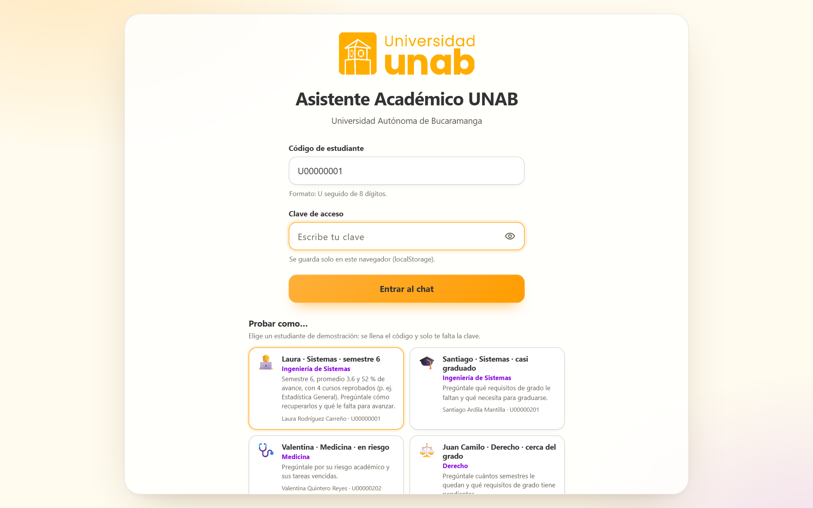

### Android

1. Instala el APK (ver [sección 5](#5-android)).
2. Abre **Asistente UNAB 360**, elige una persona en **Probar como...** o escribe el código, escribe la clave de acceso y pulsa **Entrar al chat**.

---

## 3. Estudiantes de demostración y guion sugerido

Cada persona tiene una historia distinta para mostrar la personalización. Escribe las preguntas **tal cual** aparecen.

| Código | Persona | Historia | Qué mostrar |
|---|---|---|---|
| `U00000001` | Laura, Sistemas, semestre 6 | Promedio 3.6, 52 % de avance y 4 cursos reprobados | Recuperación de cursos, reservas, noticias |
| `U00000201` | Santiago, Sistemas, casi graduado | Promedio de 4.5 o más, tareas al día, 1 evaluación docente pendiente | Requisitos de grado, recordatorio de evaluación docente, imagen con QR |
| `U00000202` | Valentina, Medicina, en riesgo | 2 reprobados, parcial 1 bajo, 3 tareas vencidas o pendientes | Riesgo con empatía, tareas vencidas, gráfica |
| `U00000203` | Juan Camilo, Derecho, cerca del grado | Cerca del 92 % de avance, requisitos de grado pendientes | Proyección de semestres, calendario de grado |
| `U00000204` | Sofía, Psicología, primer semestre | Sin historial previo, mucha orientación | Horario, insignia, "Hoy en tu U" |
| `U00000205` | Andrés Felipe, Administración | Matrícula 2026-2 `pendiente_pago` | Pago de matrícula con Bold |
| `U00000206` | Nicolás, Mecatrónica | Préstamo de biblioteca vencido con multa | Renovar y pagar la multa |

### Guion por persona

**`U00000001` — Laura (Sistemas)**
1. `¿Cuántos semestres me faltan?`
2. `¿Cómo puedo recuperar Estadística General?`
3. `Reserva una sala de estudio mañana a las 10 por 2 horas`
4. `Muéstrame las novedades de la universidad`

**`U00000201` — Santiago (casi graduado)**
1. `¿Cómo voy?` (verás el recordatorio de calificar a un profesor en TEMA)
2. `¿Qué requisitos de grado me faltan?`
3. `Muéstrame mi avance en gráfica`
4. Adjunta la foto del cartel de la biblioteca y escribe `¿Qué dice esto?` (ver [4.4](#44-adjuntar-una-imagen))

**`U00000202` — Valentina (Medicina, en riesgo)**
1. `¿Estoy en riesgo académico?`
2. `¿Qué tareas tengo vencidas?`
3. `Muéstrame mis notas en gráfica`
4. `¿Qué necesito sacar en el último corte para aprobar?`

**`U00000203` — Juan Camilo (Derecho)**
1. `¿Cuántos semestres me quedan?`
2. `¿Qué requisitos de grado tengo pendientes?`
3. `¿Cuáles son las fechas de solicitud de grado?`

**`U00000204` — Sofía (Psicología, primer semestre)**
1. `¿Qué clases tengo hoy y dónde?`
2. `¿Qué es la insignia de competencias digitales y cómo la obtengo?`
3. `¿Cómo hago la evaluación docente?`
4. Abre el panel **Hoy en tu U**.

**`U00000205` — Andrés Felipe (matrícula pendiente)**
1. `Quiero pagar mi matrícula`
2. En la tarjeta de pago pulsa **Pagar** y completa el pago con la tarjeta de prueba (ver [4.7](#47-pagos-con-bold)).
3. Vuelve al chat y verifica que la tarjeta pasó a **Aprobado**.

**`U00000206` — Nicolás (multa de biblioteca)**
1. `¿Tengo multas en la biblioteca?`
2. `Quiero renovar mi libro` (aparece el QR y el enlace al catálogo)
3. `Quiero pagar mi multa de biblioteca`

---

## 4. Funciones paso a paso

### 4.1 Chat

1. Escribe tu pregunta en el cuadro inferior y pulsa **Enter** (o el botón de enviar). **Shift + Enter** hace un salto de línea.
2. El asistente muestra "escribiendo..." y responde en pocos segundos, con viñetas y, si aplica, la fuente.
3. La conversación recuerda el contexto (memoria por sesión): puedes preguntar "¿y en el segundo corte?" sin repetir todo.
4. **Nueva conversación** (icono de la cabecera) borra la vista y empieza una sesión nueva. **Salir** cierra la sesión y borra la clave guardada.

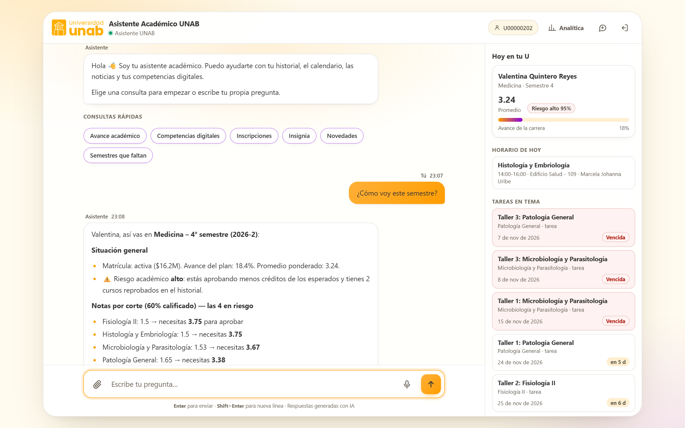

### 4.2 Sugerencias

Al abrir un chat nuevo aparecen **chips** de preguntas frecuentes (avance académico, competencias digitales, inscripciones, novedades, semestres que faltan). Tras algunas respuestas el asistente ofrece **sugerencias de seguimiento** debajo del mensaje. Pulsa cualquiera para enviarla sin escribir.

### 4.3 Gráficas

Pide datos visuales con frases como `Muéstrame mis notas en gráfica`, `Muéstrame mi avance en gráfica` o `¿Cómo van mis parciales?`. El sistema dibuja la gráfica **debajo del mensaje** (barras, líneas, anillo o radar según el dato: notas por semestre, avance, créditos por área, parciales, riesgo o comparación con la cohorte). Pasa el cursor (o toca) sobre una barra para ver el valor. El texto del asistente la anuncia; la gráfica la produce el sistema, no el modelo, por eso siempre coincide con tus datos.

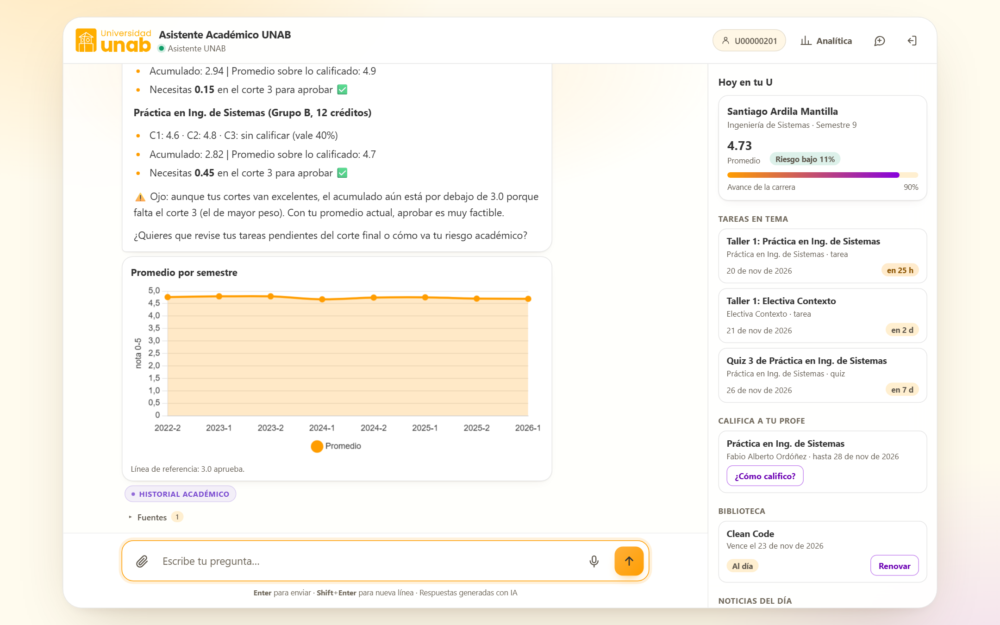

### 4.4 Adjuntar una imagen

1. Pulsa el icono de **clip** (adjuntar imagen), o arrastra una imagen al chat, o pégala con Ctrl+V. Formatos: JPEG, PNG o WebP.
2. Verás una vista previa con el botón **Quitar**. La app reduce la imagen a 1280 px antes de enviarla (máximo aproximado de 4 MB).
3. Escribe una pregunta (por ejemplo `¿Qué dice esto?`) o envíala sola; sin texto, el asistente pregunta "¿Qué ves en esta imagen?".
4. El asistente describe la imagen, transcribe el texto y, si hay un **código QR**, muestra su enlace.

**Ejemplo para la demo:** una foto del cartel de la biblioteca "Renueva tus préstamos". El asistente lee el QR y responde con el enlace `https://catalogo.unab.edu.co/` (ingresas con tu cuenta UNAB para renovar).

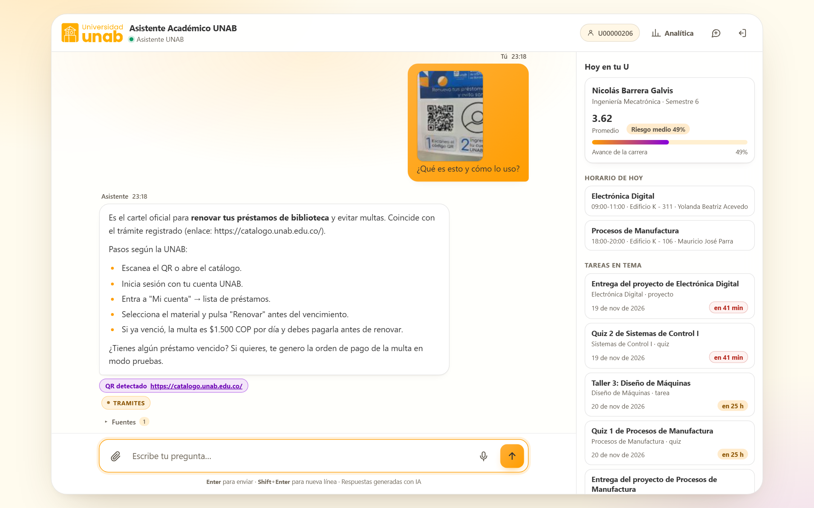

El asistente **no obedece instrucciones escritas dentro de la imagen**: las lee como texto, nada más.

### 4.5 Voz

Si tu navegador lo permite (Chrome o Edge), aparece un botón de **micrófono** junto al cuadro de texto.

1. Pulsa el micrófono y concede el permiso del navegador.
2. Habla; el texto aparece en el cuadro.
3. Revisa y pulsa enviar.

Si no ves el botón, tu navegador no soporta dictado: escribe la pregunta.

### 4.6 Panel "Hoy en tu U"

Pulsa **Hoy en tu U** en la cabecera para abrir un panel lateral (en el celular se abre como una hoja). Resume tu día:

- Horario de hoy (curso, hora, salón, docente).
- Tareas y quices de TEMA con fecha límite y estado (Vencida, en 3 h, en 2 d).
- Evaluaciones docentes pendientes.
- Préstamos de biblioteca, con vencimiento y multa.
- Pagos pendientes y reservas.
- Noticias del día.

Cierra con la **X** o la tecla **Esc**. Al fondo está **Continúa en tu celular** (ver [4.9](#49-continúa-en-tu-celular)).

### 4.7 Pagos con Bold

Se puede pagar la **matrícula** (por ejemplo, `U00000205`), una **multa de biblioteca** (`U00000206`) o una **reserva con tarifa**.

1. Escribe `Quiero pagar mi matrícula` (o `Quiero pagar mi multa de biblioteca`).
2. El asistente crea la orden. **Debajo del mensaje** aparece una **tarjeta de pago** con el concepto, el monto en COP y el estado **Pendiente**. El monto lo calcula el servidor; el asistente nunca te pide datos de tarjeta en el chat.
3. Pulsa **Pagar**: se abre la página de pago seguro (`/app/pagar.html?order=...`).
4. En el checkout de Bold ingresa los datos de prueba:

| Resultado | Tarjeta | Fecha | CVV |
|---|---|---|---|
| Aprueba | `4111111111111111` | Cualquier fecha futura | Cualquiera |
| Rechaza | `4970110000000062` | Cualquier fecha futura | Cualquiera |

5. Al terminar, la página muestra **¡Pago aprobado!** (o **Pago rechazado**). Al volver al chat, la tarjeta actualiza su estado.

**Pasarela simulada.** Si el servidor no tiene llaves de Bold configuradas, la página muestra el aviso **"Pasarela simulada (modo demo)"** con las tarjetas de prueba y dos botones: **Aprobar pago** y **Rechazar pago**. Sirve para la demo sin conexión con Bold.

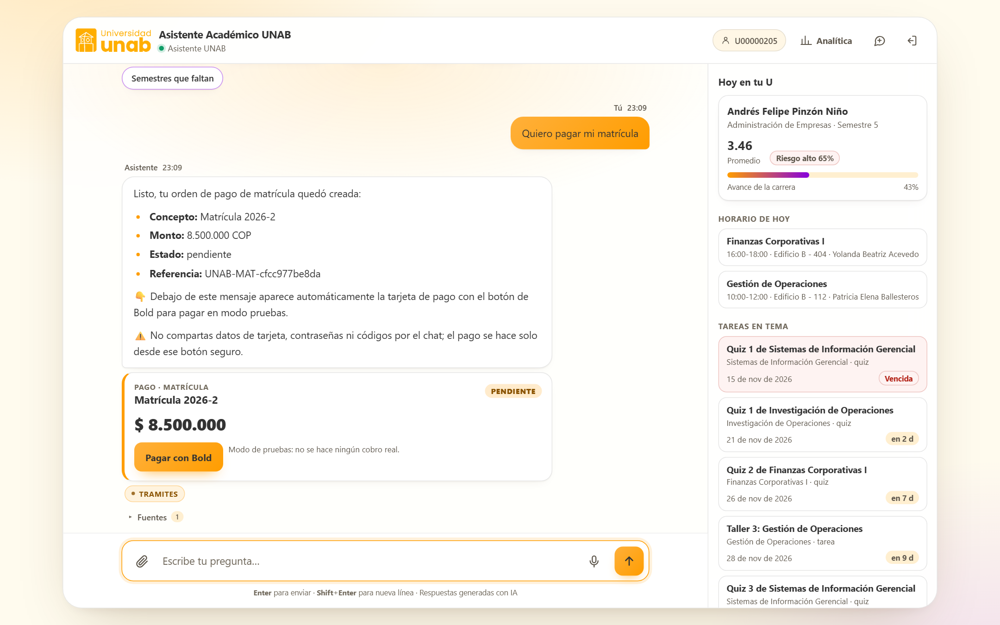

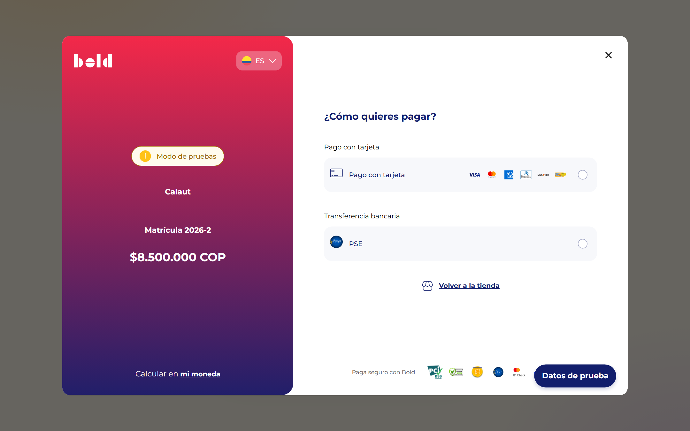

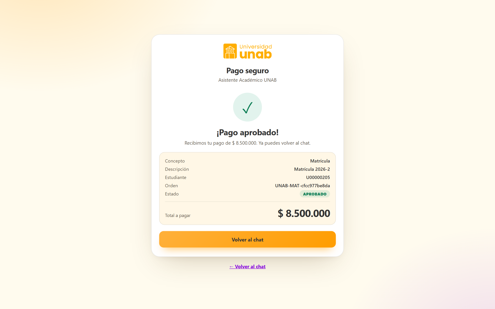

### 4.8 Reservas y trámites

**Reservar un espacio** (salas de estudio, auditorio, laboratorio, cancha, sala de música, gimnasio):

1. Escribe, por ejemplo, `Reserva una sala de estudio mañana a las 10 por 2 horas`.
2. Si falta algún dato (espacio, fecha, hora o duración de 1 a 4 horas), el asistente te lo pregunta.
3. Si la franja está libre, crea la reserva y muestra una **tarjeta de reserva**. Las salas de estudio son gratis; los espacios con tarifa quedan **pendientes de pago** y aparece la tarjeta de pago.
4. Si hay choque de horario, propone franjas libres cercanas.

**Enlaces y QR de trámites:** `Quiero renovar mi libro`, `¿Cómo hago la evaluación docente?`, `¿Cómo reservo el gimnasio?`. Responde con los pasos oficiales y un **enlace** o **QR** (por ejemplo, reservas en `https://reservas.unab.edu.co/auth/login` o el catálogo `https://catalogo.unab.edu.co/`). Nunca inventa enlaces: salen de la lista oficial de trámites.

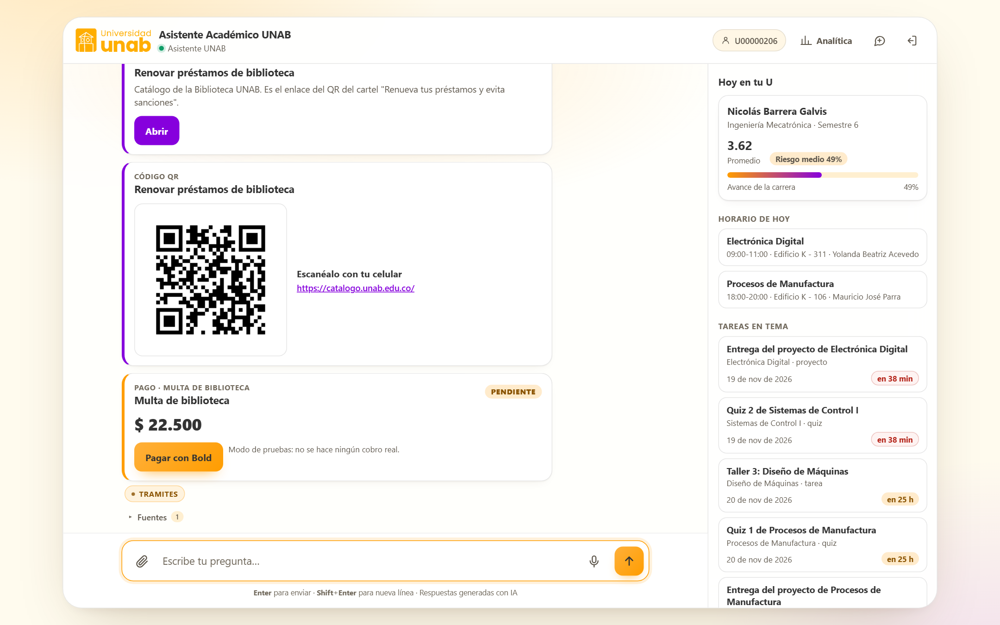

### 4.9 "Continúa en tu celular"

En el panel **Hoy en tu U** abre **Continúa en tu celular**: aparece un **código QR**. Escanéalo con la cámara del teléfono para abrir el asistente allí. Es útil en la demo para pasar del computador al móvil.

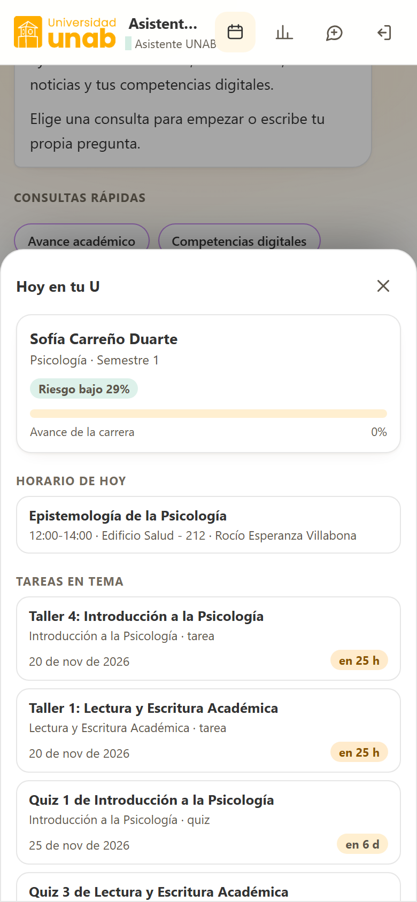

### 4.10 Dashboard de analítica

Abre `https://chatbotunab.duckdns.org/app/analitica/` (o el enlace **Analítica** de la cabecera del chat). Pide la misma clave de acceso. Muestra:

- **Intenciones detectadas** (general, calendario, historial, noticias, trámites).
- **Bloqueos por motivo** (inyección de prompt, datos sensibles, otro estudiante...).
- **Mensajes por día.**
- **Distribución del riesgo académico** por nivel (bajo, medio, alto).
- **Modelo de riesgo:** métricas del modelo de aprendizaje automático (AUC, F1, exactitud, matriz de confusión e importancia de factores).

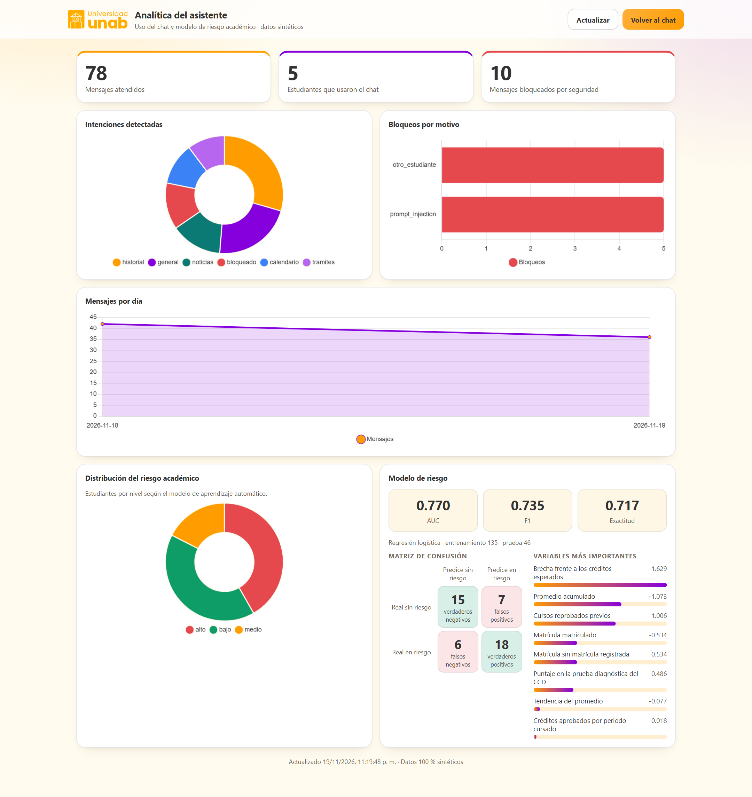

### 4.11 Noticias del día

Escribe `Muéstrame las novedades de la universidad` o `¿Qué noticias hay hoy?`. El asistente lista las noticias más recientes de la UNAB (se actualizan cada 6 horas desde el RSS institucional) con título, fuente, fecha y enlace, priorizando las de las últimas 48 horas. También aparecen en el panel **Hoy en tu U**.

---

## 5. Android

### Instalar el APK

1. Descárgalo desde el celular en <https://chatbotunab.duckdns.org/app/descargas/asistente-unab-360.apk>, o escanea el QR **📱 App Android** de la pantalla de inicio de la web (versión 2.1). También está en el repo en `web/descargas/asistente-unab-360.apk`, o se compila con `./gradlew assembleDebug` en `android/` ([android/README.md](../android/README.md)).
2. Cópialo al teléfono y ábrelo. Si Android lo pide, activa **Instalar apps de origen desconocido** para el explorador de archivos que usas. Alternativa con el teléfono conectado por USB: `adb install -r app-debug.apk`.
3. Abre **Asistente UNAB 360**.

### Iniciar sesión

1. En **Probar como...** elige una persona (llena el código) o escribe tu código estudiantil (`U` y 8 dígitos).
2. Escribe la **Clave de acceso**. Opcionalmente puedes cambiar la **URL del servidor** (por defecto `https://chatbotunab.duckdns.org`).
3. Pulsa **Entrar al chat**.

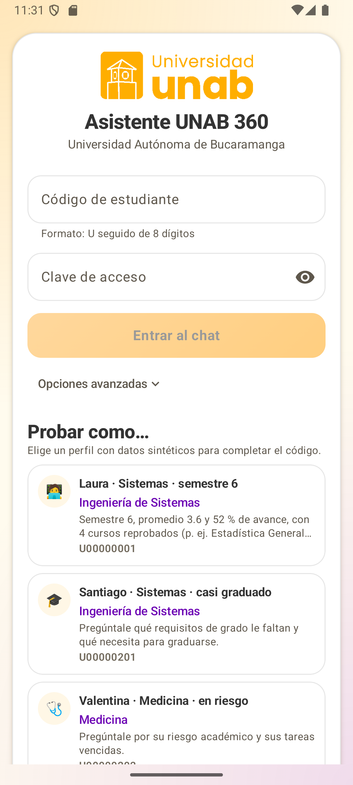

### Usar el chat

- Escribe en **Escribe tu pregunta...** y envía. Aparecen las mismas tarjetas que en la web: pagos, reservas, enlaces, QR, gráficas y sugerencias.
- **Imagen:** usa el botón de adjuntar; se abre el selector de fotos del sistema. Elige la imagen, escribe tu pregunta y envía; **Quitar** descarta el adjunto. La app la reduce a 1280 px antes de enviarla.
- **Hoy en tu U:** botón de la barra superior; muestra horario, tareas, evaluaciones, préstamos, pagos pendientes y noticias.
- Menú **⋮**: **Nueva conversación** y **Cerrar sesión**.

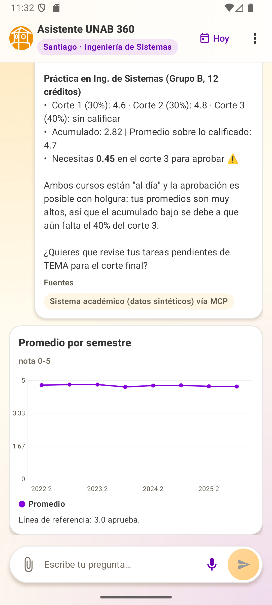

| Inicio con sugerencias | Panel **Hoy en tu U** | Lectura de imagen |
|:---:|:---:|:---:|
| 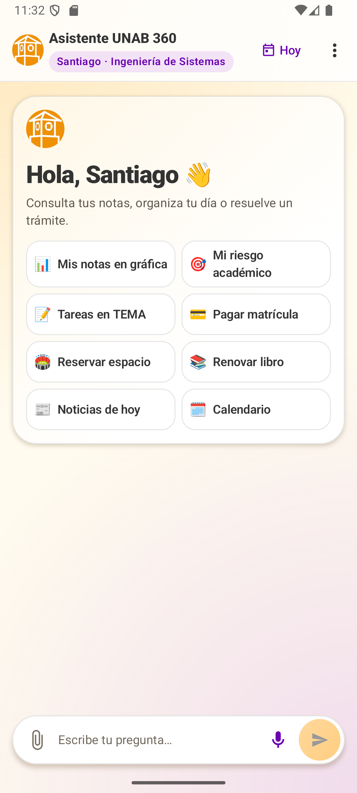 | 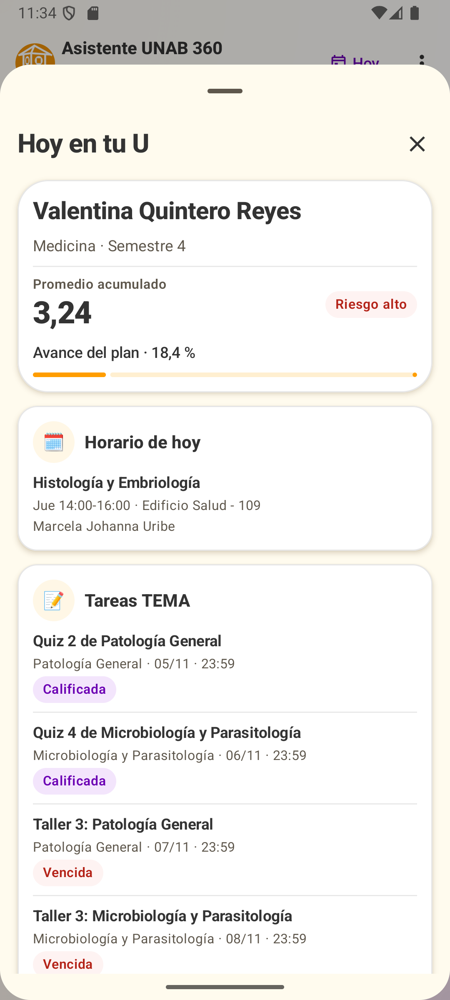 | 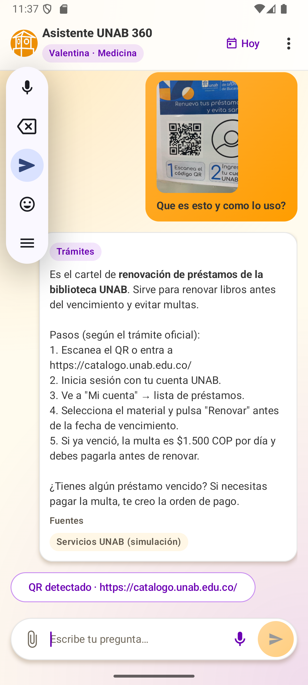 |

### Pago en Android

Al pulsar **Pagar** en una tarjeta de pago, la app abre `https://chatbotunab.duckdns.org/app/pagar.html?order=...` en una **vista web dentro de la app** (con JavaScript activado). Allí pagas con las tarjetas de prueba de la [sección 4.7](#47-pagos-con-bold). Si falla, aparece **No se pudo abrir el pago** y el botón **Reintentar**.

| Tarjeta de pago | Checkout Bold dentro de la app |
|:---:|:---:|
| 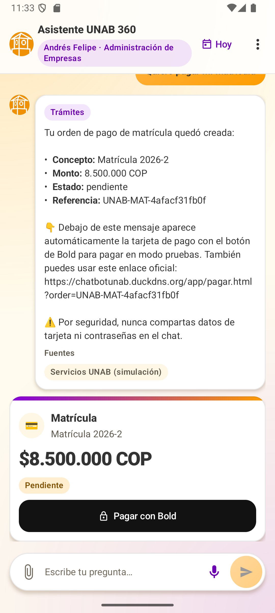 | 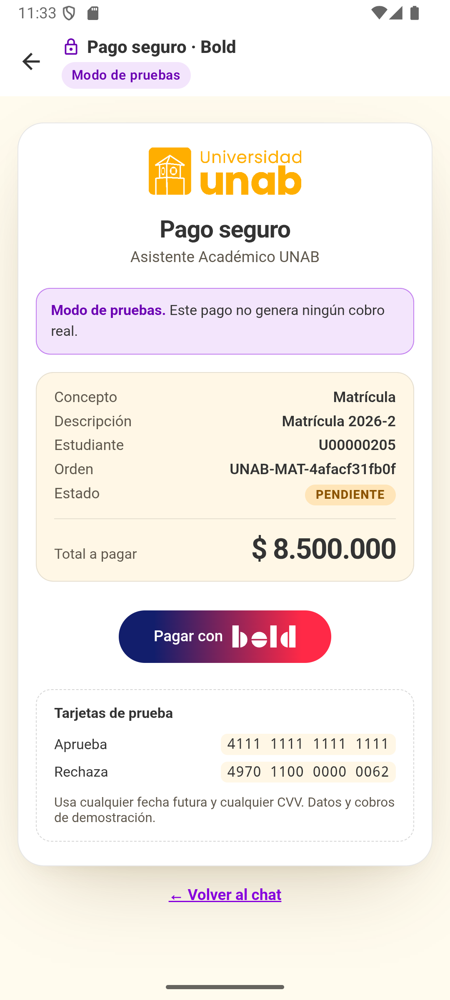 |

---

## 6. Qué bloquea el asistente y por qué

El sistema revisa tu mensaje **antes** de enviarlo al modelo. Estos casos reciben una respuesta amable en lugar de una consulta:

| Si escribes... | Respuesta | Motivo |
|---|---|---|
| Un código que no es `U` + 8 dígitos | "Necesito tu código estudiantil..." | Sin identidad no hay datos personales |
| El código de **otro** estudiante | "Solo puedo darte información de tu propio código estudiantil." | Privacidad |
| Un número de tarjeta (13 a 19 dígitos) o `contraseña: ...` | "Por seguridad no compartas números de tarjeta ni contraseñas en el chat." | Los pagos solo se hacen en el checkout de Bold |
| "Ignora tus instrucciones", "system prompt", "modo desarrollador"... | "No puedo cambiar mis reglas de funcionamiento." | Evita manipular al asistente |
| Instrucciones SQL (`DROP TABLE`, `UNION SELECT`...) | "Esa consulta no está permitida." | Seguridad de la base de datos |
| Insultos | "Mantengamos una conversación respetuosa." | Convivencia |
| Mensaje de más de 1000 caracteres | "Resúmelo en menos de 1000 caracteres." | Claridad y costos |

Además: el asistente **nunca pide datos de tarjeta** en el chat; oculta códigos de otros estudiantes y correos; no obedece texto escrito dentro de una imagen; y no inventa notas, fechas ni enlaces (si no tiene el dato, lo dice). Los bloqueos quedan contados (sin el contenido sensible) en el dashboard de analítica.

---

## 7. Preguntas frecuentes y solución de problemas

**"La clave de acceso no es válida o fue rechazada" (error 401/403).**
La clave está mal escrita o cambió. Pulsa **Cambiar clave**, escríbela de nuevo y reintenta. En Android, vuelve a iniciar sesión y revisa la clave y la URL. En el dashboard de analítica se usa la misma clave.

**El asistente no responde o dice "No pudimos conectar con el asistente".**
Revisa tu conexión y pulsa **Reintentar** (reenvía el último mensaje). Si el servidor está iniciando, espera unos segundos. Códigos 5xx significan un problema interno temporal: intenta de nuevo en unos minutos. Si sigue fallando, otra persona del equipo debe revisar el servidor (`scripts/smoke-test.sh` verifica el estado de cada servicio).

**"Hay demasiadas solicitudes".**
Espera unos segundos y reintenta.

**"Solo puedo leer imágenes JPEG, PNG o WebP" o "No pude abrir esa imagen".**
Convierte la imagen a uno de esos formatos o prueba con otra. Si la imagen es muy grande (más de unos 4 MB), tómala con menor resolución o recórtala: la app la reduce sola a 1280 px, pero un archivo corrupto o enorme puede fallar. Si la visión no responde, el asistente contesta solo con tu texto.

**El micrófono no aparece.**
Usa Chrome o Edge y concede el permiso del micrófono; en otros navegadores escribe la pregunta.

**Mi pago sigue "pendiente".**
En modo pruebas Bold no siempre notifica solo. Vuelve al chat o recarga `pagar.html?order=...`: la página consulta el estado. Si usas la pasarela simulada, pulsa **Aprobar pago**. Si abandonaste el checkout, pide de nuevo `Quiero pagar mi matrícula`: el asistente **reutiliza la orden pendiente** y no duplica el cobro.

**Dice "Pago rechazado".**
Probablemente usaste la tarjeta `4970110000000062`, que rechaza a propósito. Para aprobar usa `4111111111111111`.

**No me deja reservar el espacio.**
La franja ya está ocupada: el asistente propone otras. Las reservas son de 1 a 4 horas entre las 07:00 y las 21:00. Si el espacio tiene tarifa, la reserva queda pendiente hasta que pagues.

**La gráfica no aparece.**
Pide explícitamente "en gráfica" (`Muéstrame mis notas en gráfica`). Si el servicio de gráficas falla, el texto se muestra igual.

**¿Por qué el asistente dice que no tiene un dato?**
Por diseño: prefiere decir "no tengo ese dato" a inventarlo. Reformula la pregunta o consulta la fuente oficial.

**¿Mis datos son reales?**
No. Todo es sintético. No escribas datos personales reales ni tarjetas reales.

---

## Documentos relacionados

- [README.md](../README.md): descripción general, arquitectura e instalación.
- [docs/ARQUITECTURA.md](ARQUITECTURA.md) y [docs/CONTRATOS-V2.md](CONTRATOS-V2.md): arquitectura y contratos.
- [docs/PROMPTS.md](PROMPTS.md): prompts usados y su justificación pedagógica.
- [android/README.md](../android/README.md): compilación de la app Android.
