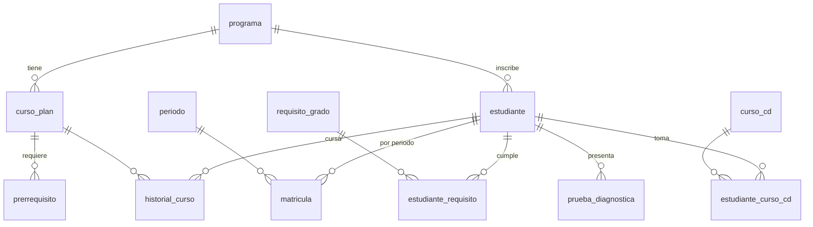

# Modelo de datos

Base `unab` en PostgreSQL 16 + pgvector. Esquema `academico` = simulación sintética de Banner/Cosmos.

Tablas independientes: `calendario_evento`, `noticia`, `chat_log`. En `public`: `rag_documentos` (la crea n8n: `id, text, metadata jsonb, embedding vector`) y `n8n_chat_histories` (memoria). La BD `n8n` es interna de n8n.

## Vistas para agentes

| Vista | Una fila = | Usada por |
|---|---|---|
| `v_estado_academico` | estado de un estudiante: matrícula del periodo, créditos, % avance, promedio ponderado | `estado_academico`, `recomendaciones` |
| `v_cursos_pendientes` | un curso del plan no aprobado por un estudiante | `cursos_pendientes` |
| `v_alertas_prerrequisitos` | un curso bloqueado + el prerrequisito que falta | `alertas_requisitos` |
| `v_requisitos_grado` | estado de un requisito de grado por estudiante | `alertas_requisitos` |
| `v_proyeccion` | semestres restantes estimados | `proyeccion_semestres` |
| `v_competencias_digitales` | un curso del CCD tomado | `competencias_digitales` |
| `v_insignia` | progreso hacia la insignia | `competencias_digitales`, `recomendaciones` |
| `v_noticias_recientes` | noticia ordenada por fecha | `noticias_recientes`, workflow 04 |

**Regla de proyección:** ritmo = créditos aprobados / (semestre actual − 1), acotado entre 12 y 20; semestres restantes = ⌈(créditos restantes − cursando) / ritmo⌉ + 1 si está cursando.

**Regla de insignia (sintética):** 3 cursos del CCD aprobados y al menos uno intermedio o avanzado.

## Datos sintéticos

`scripts/generate_synthetic.py` (semilla fija 42, sin dependencias) produce `db/init/03_seed.sql`:

| Entidad | Cantidad |
|---|---|
| Programa / cursos del plan | 1 / 48 (151 créditos, 9 semestres, del PDF real) |
| Prerrequisitos (ilustrativos) | 31 |
| Periodos | 2021-1 … 2026-2 (actual) |
| Estudiantes | 200 (`U00000001` … `U00000200`) |
| Historial de cursos | ~6.200 registros (notas ~ N(habilidad, 0,6); se reprueba con < 3,0 y se repite el periodo siguiente) |
| Matrículas | ~930 (periodo actual: 80 % matriculado, 10 % pendiente de pago, 5 % preinscrito, 5 % aplazado) |
| Cursos CCD | 11 (básico/intermedio/avanzado) |

Estudiante demo **U00000001**: 6.º semestre, 78/151 créditos (51,7 %), promedio 3,6, reprobó *Estadística General* (bloquea *Ciencias de Datos* e *Investigación de Operaciones*), 2 cursos del CCD (le falta 1 para la insignia), ~4 semestres restantes. Sirve para mostrar alertas y recomendaciones en el video.
